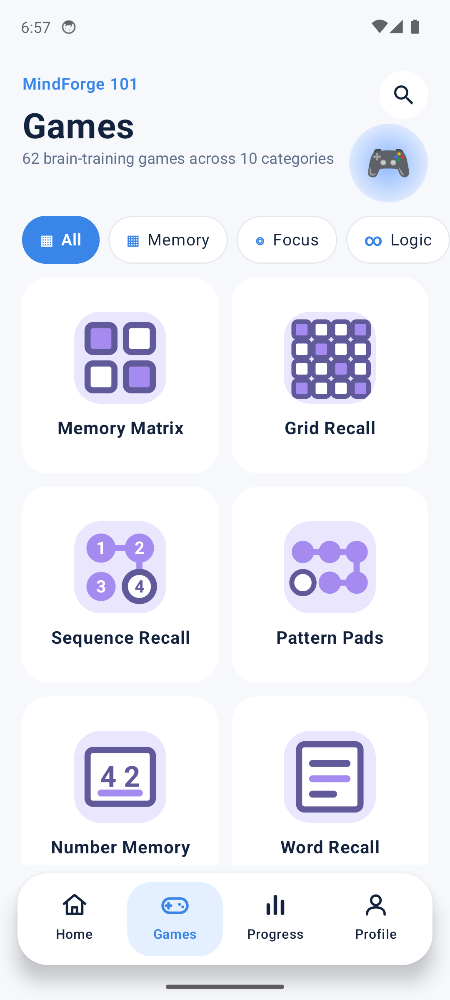
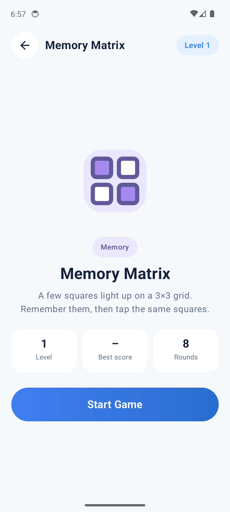
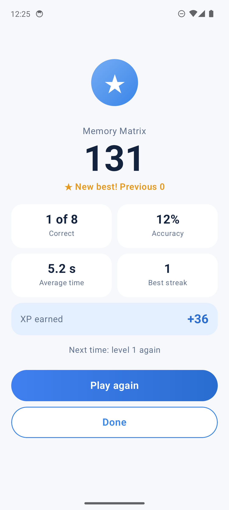
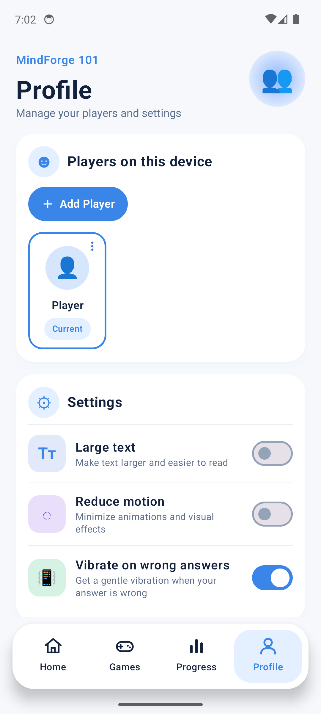

<p align="center">
  
</p>

<p align="center">
  <a href="https://github.com/arlotechnologiesinfo-beep/MindForge/releases/latest"></a>
  
  
  
  
</p>

<p align="center">
  <b>62 quick games &nbsp;|&nbsp; 10 skill categories &nbsp;|&nbsp; adaptive difficulty &nbsp;|&nbsp; no ads, no accounts, no internet</b>
</p>

<p align="center">
  <a href="https://github.com/arlotechnologiesinfo-beep/MindForge/releases/latest"><b>Download the APK</b></a>
  &nbsp;&middot;&nbsp; <a href="#build-from-source">Build from source</a>
  &nbsp;&middot;&nbsp; <a href="docs/app-guide.md">App guide</a>
  &nbsp;&middot;&nbsp; <a href="#architecture">Architecture</a>
</p>

---

## Screenshots

<table>
  <tr>
    <td align="center"><br><sub><b>62 games</b><br>one tap to open</sub></td>
    <td align="center"><br><sub><b>Game intro</b><br>how to play, level, best score</sub></td>
    <td align="center"><br><sub><b>Results</b><br>score, accuracy, XP</sub></td>
    <td align="center"><br><sub><b>Profiles and settings</b><br>large text, reduce motion</sub></td>
  </tr>
</table>

## Why MindForge

- **Private by design.** No account, no ads, no analytics, no tracking. The app does not request the `INTERNET` permission, so nothing can leave the device.
- **Short sessions.** Each game is 8 rounds, about a minute. A 5-game *Daily Brain Mix* keeps a routine simple.
- **Adapts to you.** Difficulty moves up or down between sessions based on accuracy and speed.
- **Rewarding, not noisy.** XP, ranks, daily streaks and 16 achievements, with calm motion that respects *Reduce motion*.
- **Shared devices.** Several players can keep separate progress on one phone.

> MindForge is a game, not a medical or diagnostic tool. Scores are not an IQ measure.

## Features

| | |
|---|---|
| **Games** | 62 games in 10 categories: Memory, Focus, Logic, Math, Words, Spatial, Speed, Strategy, Problem Solving, Visual |
| **Progression** | XP, rank ladder, per-category performance, 16 achievements, daily streak |
| **Daily Brain Mix** | A fresh 5-game workout plus a focus card for your weakest category |
| **Profiles** | Multiple local players, each with their own stats; rename and delete supported |
| **Design** | Custom design system, floating bottom navigation, a code-drawn icon for every game, bundled Lottie animations |
| **Accessibility** | Large text option, Reduce motion option, labelled controls, high-contrast feedback that never relies on colour alone |

Every game and screen is described in [docs/app-guide.md](docs/app-guide.md).

## Tech stack

| Layer | Choice |
|---|---|
| Language | Kotlin |
| UI | Jetpack Compose, Material 3, Navigation Compose |
| Storage | Room (progress, sessions, achievements, profiles), DataStore (settings) |
| Animation | Compose animation APIs, Lottie (`lottie-compose`, bundled JSON, offline) |
| Build | Gradle (Kotlin DSL), R8 minify and resource shrinking in release |
| SDK | min 24 (Android 7.0), target and compile 36; `java.time` on API 24-25 via core library desugaring |

## Build from source

**Requirements:** Android Studio (current stable) or the Android command line tools, **JDK 21** (JDK 25 is not supported by the Gradle/AGP version in use), Android SDK platform 36.

```bash
git clone https://github.com/arlotechnologiesinfo-beep/MindForge.git
cd MindForge

# Debug build, installed on a connected device or emulator
./gradlew installDebug

# Unit tests
./gradlew testDebugUnitTest
```

On Windows with Git Bash, point `JAVA_HOME` at a JDK 21 first, and make sure `local.properties` has your SDK path:

```bash
export JAVA_HOME="/c/Program Files/Eclipse Adoptium/jdk-21.0.12.101-hotspot"
```

```properties
# local.properties (not committed)
sdk.dir=/path/to/Android/Sdk
```

### Release build

Release builds are minified and signed when `keystore.properties` exists in the project root. Without it the release build is unsigned.

```properties
# keystore.properties (never commit this or the .jks)
storeFile=mindforge-release.jks
storePassword=...
keyAlias=...
keyPassword=...
```

```bash
./gradlew assembleRelease   # APK -> app/build/outputs/apk/release/
./gradlew bundleRelease     # AAB -> app/build/outputs/bundle/release/  (upload this to Google Play)
```

`*.jks`, `*.keystore`, `keystore.properties` and `local.properties` are gitignored. Keep a backup of the keystore somewhere safe: without it you cannot update a published app. Bump `versionCode` in `app/build.gradle.kts` for every upload.

## Architecture

```
app/src/main/java/com/mindforge101/app/
  MainActivity.kt          entry point, navigation, splash, theme and settings wiring
  data/                    Room database, DataStore settings, Repository
  domain/                  models, adaptive difficulty engine, ranks, achievements, daily mix
  games/                   catalog and the 62 game generators, grouped by category
  ui/
    DesignSystem.kt        colours, spacing, shapes, motion tokens, press feedback
    Theme.kt               Material theme, large-text and reduce-motion locals
    BottomNav.kt           floating bottom bar
    Home / Games / Progress / Profile / Result screens
    Gameplay.kt            session runner and the game view types
    GameplayComponents.kt  answer options, keypad, play cells, progress bars
    GameIcons.kt           code-drawn vector icon for every game
    GameInstructions.kt    how-to-play text for every game
    GameIntro.kt           pre-game intro screen
    MfLottie.kt            offline Lottie player (respects Reduce motion)
app/src/main/res/raw/      bundled Lottie animations
app/src/test/              unit tests: engine, games, icon and instruction coverage
docs/                      app guide, privacy policy, store listing, banner, screenshots
```

**How it fits together**

- **A game is data plus a generator.** Each game in `games/` produces `Round` objects. `Gameplay.kt` picks a view type (choice, number, grid, sequence, glyph grid, phased, countdown) and renders it. Scoring, XP, adaptive level and achievements live in `domain/` and `data/`, independent of the UI.
- **One theme, one motion vocabulary.** All colours come from `MfColors`; every animation reads `LocalReduceMotion`.
- **Icons are code.** `GameIcons` draws each game on a 24-unit grid. A unit test fails if a game is added without an icon or instruction text.
- **Offline by design.** No network libraries, no remote assets. Fonts and animations are bundled.

### Adding a game

1. Add its generator to the matching file under `games/` and register it in `Catalog.kt`.
2. Add its icon drawer to `GameIcons.kt` and its text to `GameInstructions.kt`.
3. Run `./gradlew testDebugUnitTest`. `GameIconCoverageTest` checks the icon and instructions exist.

## Releasing to Google Play

1. Bump `versionCode` and `versionName`.
2. `./gradlew bundleRelease`, then upload the `.aab`.
3. Use [docs/release/store-listing.md](docs/release/store-listing.md) for the listing text and [docs/release/privacy-policy.md](docs/release/privacy-policy.md) as the privacy policy (host it at a public URL).
4. Provide the store icon, feature graphic and screenshots.

## Privacy

MindForge collects no personal data and makes no network requests. See the [privacy policy](docs/release/privacy-policy.md).

## License

No license has been chosen yet. Until one is added, all rights are reserved by the author.

<p align="center"><sub>Built by Arlo Technologies</sub></p>
